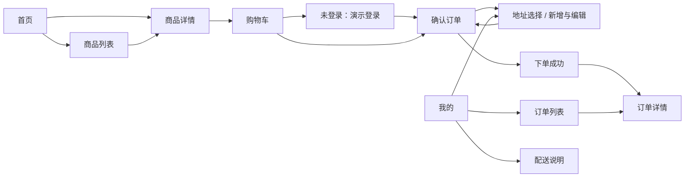

# 鲜邻 · 生鲜商城 APP 团队评审版

鲜邻面向日常购买生鲜的家庭用户，提供浏览商品、加购、确认收货地址和提交演示订单的完整体验。沿用已选定的奶油白、橄榄绿与暖橙视觉方案；本版供团队评审，不涉及真实交易。

## 评审入口

- [团队评审入口与全页面预览](http://127.0.0.1:4180/screens.html)：购物流程指引、13个页面和14个补充状态截图。
- [可交互 APP 原型](http://127.0.0.1:4180/)：实际体验购物、地址管理、下单及订单查询。
- [产品需求文档](prd.md)、[Design QA 结果](fresh-market/design-qa.md)。

截图用于查看页面设计，点击图片会打开原尺寸图片；要操作商品或下单，请点击评审入口的“开始购物体验”。

当前按要求保留本地评审版，未发布在线分享链接。127.0.0.1仅供运行原型的这台电脑访问，不能直接发给其他设备使用。

## 5分钟完整购物体验

建议使用新的浏览器会话开始，以免已有演示数据影响评审。

1. 打开交互原型，浏览首页；点击商品图片查看详情，也可通过底部“分类”进入商品列表并选择商品。
2. 在商品详情调整数量，点击“加入购物车”，然后点击购物车图标进入购物车。首页和列表也支持直接加购。
3. 在购物车检查商品数量、勾选状态和合计，点击“去下单”。只有勾选的商品参与结算；未勾选商品保留在购物车。
4. 未登录时进入演示登录页：点击“演示用户A”填入，再点击登录。也可手动输入手机号13800000001和验证码246810。正常情况下登录后直接继续确认订单；若游客购物车合并后超出库存，会先返回购物车处理。
5. 在确认订单页点击收货地址，新增地址；使用“使用范围内示例地址”可快速体验，也可填写虚构联系人、11位手机号、西湖区及含街道/小区与门牌号的完整地址。保存有效地址后自动返回确认订单。
6. 核对收货地址、商品、数量、金额和备注，点击“提交演示订单”。出现下单成功页后点击查看订单详情，再从“我的 → 我的订单”查询。无需支付。

待确认的个人演示订单可以取消，取消后释放演示库存，订单不可恢复。详情页展示只读示例订单时没有取消操作。

## 页面与跳转关系

底部导航连接首页、商品列表（分类）、购物车和我的。子页面使用顶部返回按钮返回上一层；确认订单中新增有效地址后直接回到结算。

| 页面           | 进入方式                       | 主要去向                                 |
| -------------- | ------------------------------ | ---------------------------------------- |
| 首页           | 打开原型、底部首页             | 商品列表、商品详情、购物车               |
| 商品列表       | 底部分类、首页“逛逛全部好食材” | 商品详情、购物车                         |
| 商品详情       | 首页或列表的商品图片           | 加入购物车、查看购物车、返回商品来源页   |
| 购物车         | 底部购物车、商品详情购物车图标 | 演示登录或确认订单                       |
| 演示登录       | 未登录下单、我的登录入口       | 原下单流程或我的                         |
| 确认订单       | 购物车去下单                   | 地址选择、地址编辑、下单成功             |
| 地址管理/选择  | 我的收货地址、确认订单收货地址 | 地址编辑；结算中选地址返回确认订单       |
| 新增与编辑地址 | 地址列表新增或编辑             | 地址管理；结算中保存有效地址返回确认订单 |
| 下单成功       | 提交演示订单成功               | 订单详情、继续选购                       |
| 我的           | 底部我的                       | 登录、订单列表、地址管理、配送说明       |
| 订单列表       | 我的订单                       | 个人订单详情、只读示例订单详情           |
| 订单详情       | 成功页、订单列表               | 待确认个人订单可取消、返回上一层         |
| 配送说明       | 我的配送说明                   | 查看配送范围与规则、返回我的             |



## 演示账号与数据规则

| 身份      | 手机号      | 验证码 | 适用场景                   |
| --------- | ----------- | ------ | -------------------------- |
| 演示身份A | 13800000001 | 246810 | 完整购物流程及只读示例订单 |
| 演示身份B | 13800000002 | 246810 | 对照账号数据隔离、空状态   |

- 仅支持以上两个演示身份，不发送真实短信；登录页可一键填入。
- 退出登录不会删除账号数据。不同身份的收货地址、购物车和个人订单分别保留；登录时游客购物车合并至所选身份，同商品数量相加，超出库存必须先调整。
- 数据保存在当前浏览器、当前访问地址中，演示周期为7天；到期进入重置提示，重新开始演示后恢复初始数据。刷新页面可保留尚未到期的数据。
- 不同电脑、浏览器、无痕会话或访问地址的数据不共享。评审自动化使用独立会话，不修改评审者已保存的数据。
- 初次体验、空状态检查可使用新的无痕窗口；关闭无痕会话后其数据不会继续保留。

## 注意事项与建议评审场景

- 仅演示，不收款、不发货，不需要支付；请使用虚构的联系人、手机号和地址。
- 配送范围为浙江省杭州市西湖区，配送费为0。上城区等超范围地址可保存用于演示，但不能用于提交订单。联系人、手机号和详细地址未通过校验时也不能下单。
- 可维护多个地址及默认地址。购物车数量受演示库存限制，售罄商品不可加购；牛奶库存为3，三文鱼为售罄示例。
- 提交成功后只移除本次已勾选的购物车商品。个人新订单为“待确认”；通过取消操作演示“已取消”，其余履约状态通过明确标注的只读示例订单展示，不自动推进。
- 地址编辑有未保存变更时，返回会出现确认提示；有效地址保存后按进入来源返回。不要将不可配送地址或示例订单误认为真实业务异常。
- 建议重点检查：浏览→详情→加购→下单闭环、部分勾选与金额、游客登录合并、地址校验与超区禁用、提交反馈、订单查询与取消、身份切换后的数据隔离。
- 设备选择器支持iPhone与Pixel 10预览；这是浏览器中的手机模拟原型，真实设备、屏幕阅读器与系统字号变化仍需进一步验证。

## 在另一台评审电脑运行

安装项目兼容的Node.js，复制或克隆本仓库，在仓库目录运行：

```powershell
cd fresh-market
npm ci
npm run dev -- --port 4180
```

保持终端运行，再打开上述本地评审入口。每台电脑的演示数据独立保存。若4180端口已被占用，请先确认原型服务是否已在运行；使用其他端口时相应修改浏览器访问地址。

维护评审页时运行以下命令，重新生成页面索引并检查构建：

```powershell
node scripts/create-gallery.mjs
npm run build
```
